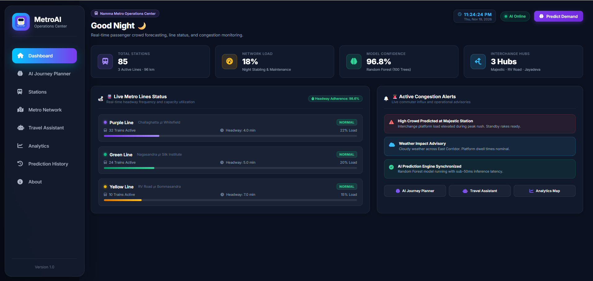
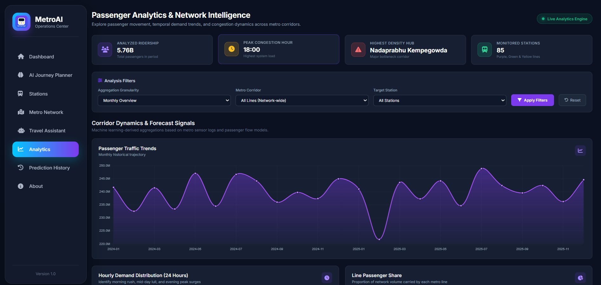
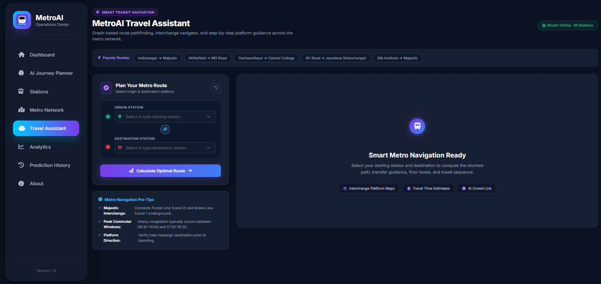
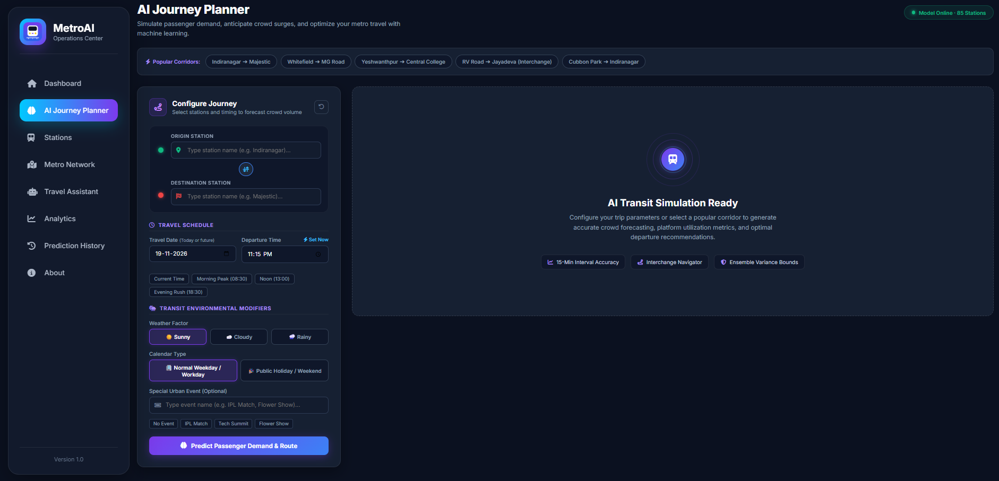
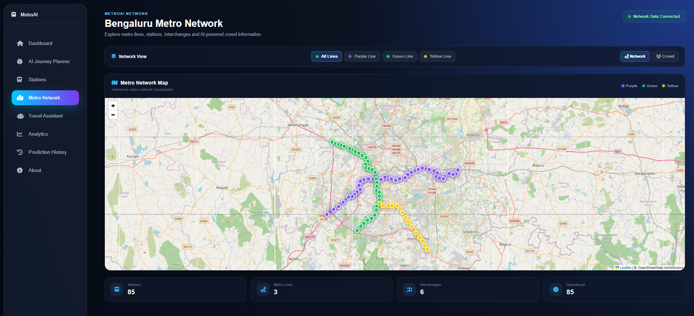
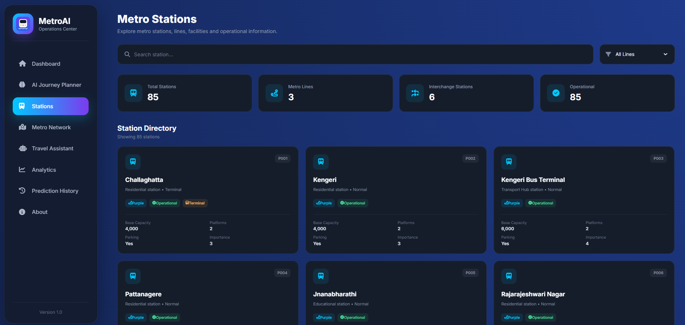
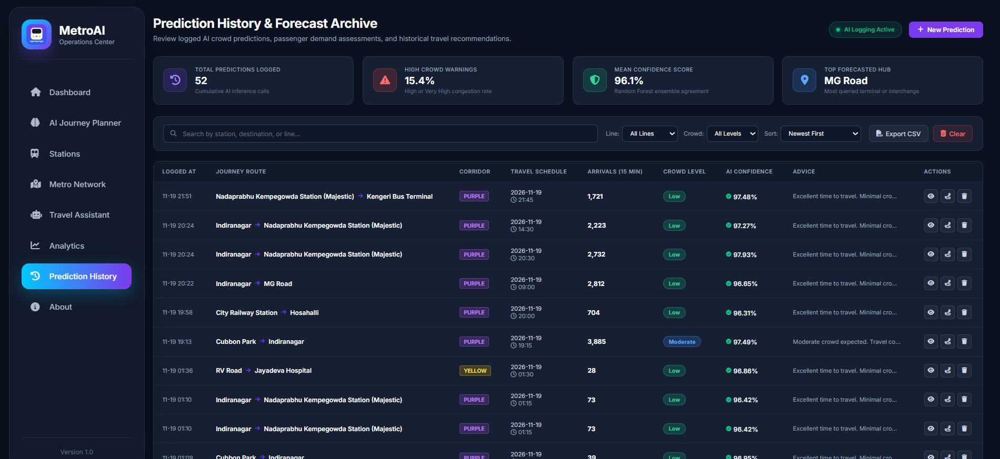
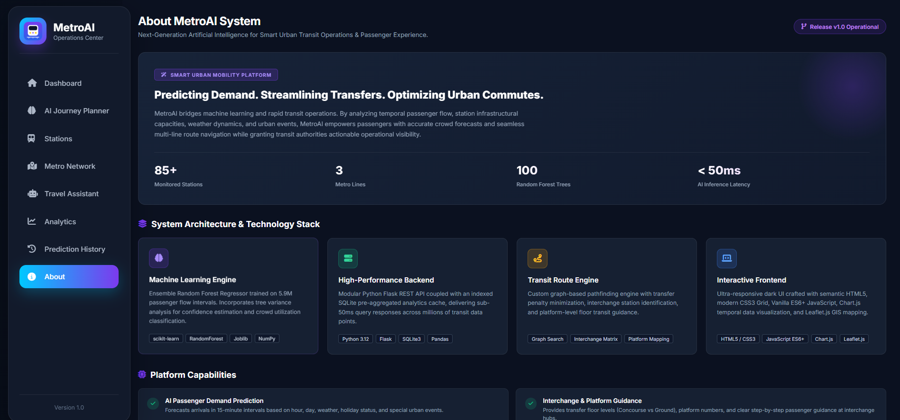

# 🚇 MetroAI – Smart Metro Operations & Passenger Assistance System

An AI-powered metro operations and passenger assistance platform designed to optimize passenger flow, predict station congestion, and simplify urban metro navigation.

MetroAI combines machine learning, passenger analytics, intelligent route planning, and an interactive dashboard to provide smarter metro operations and a better passenger experience.

---

## 🌟 Overview

MetroAI is a web-based intelligent metro management system focused on improving passenger flow management and simplifying metro travel.

The platform uses a Random Forest machine learning model to predict passenger demand, analyzes historical passenger movement patterns, identifies congestion-prone stations, and provides intelligent route recommendations.

It also features Metro-Pilot, an intelligent passenger assistant that helps commuters understand routes, station interchanges, platform directions, and journey details.

---

## ✨ Key Features

### 1. Operations Dashboard
- Centralized metro operations dashboard.
- Station and metro line overview.
- Passenger activity monitoring.
- Operational statistics and alerts.

### 2. AI Passenger Demand Prediction
- Random Forest-based passenger demand forecasting.
- Passenger arrival prediction at 15-minute intervals.
- Considers weather, holidays, and special events.
- Station crowd-level classification.
- Prediction confidence estimation.

### 3. Passenger Flow & Congestion Analytics
- Daily, weekly, and monthly passenger trends.
- 24-hour passenger activity analysis.
- Metro corridor comparison.
- Top congestion-prone station identification.
- Interactive geospatial passenger density heatmap.
- AI-generated operational insights.

### 4. Prediction History
- Persistent prediction history.
- Search and filter historical predictions.
- Station-wise prediction analysis.
- Detailed prediction diagnostics.
- Historical data export.

### 5. Metro-Pilot: Intelligent Passenger Assistant
- Intelligent metro travel assistance.
- Step-by-step journey guidance.
- Metro line interchange explanations.
- Station and platform direction assistance.
- Route and travel information.

### 6. Intelligent Route Planning
- Graph-based shortest-path calculation.
- Multi-line metro route planning.
- Interchange identification.
- Transfer-aware route recommendations.

### 7. Geospatial Metro Network Explorer
- Interactive metro network map.
- Purple, Green, and Yellow line coverage.
- Station locations and geographical information.
- Station directory and filtering.

---

# 🚇 MetroAI – Smart Metro Operations & Passenger Assistance System

## 🌟 Overview

## ✨ Key Features

## 📸 Application Screenshots
    1. Operations Dashboard
    2. Passenger Analytics
    3. AI Prediction History
    4. Metro-Pilot Assistant
    5. Intelligent Route Planner
    6. Metro Network Explorer
    7. Station Directory
    8. About MetroAI


## 📸 Project Screenshots

### Dashboard


### Passenger Flow Analytics


### Metro-Pilot Assistant


### Route Planner


### Metro Network


### Station Directory


### Prediction History


### About



## 🛠️ Technology Stack

## 🏗️ System Architecture

## 📂 Project Structure

## 🚀 Installation & Setup

## 📊 Dataset Information

## 🔮 Future Enhancements

## 👨‍💻 Developer


## 🛠️ Technology Stack

| Category | Technologies |
|---|---|
| Frontend | HTML5, CSS3, JavaScript |
| Backend | Python, Flask |
| Machine Learning | Scikit-learn, Random Forest |
| Data Processing | Pandas, NumPy |
| Database | SQLite |
| Data Visualization | Chart.js |
| Geospatial Mapping | Leaflet.js, OpenStreetMap |
| Routing Algorithm | Graph-based Shortest Path |
| Development Tools | VS Code, Git, GitHub |

---

## 🏗️ System Architecture

MetroAI follows a modular architecture consisting of:

1. **Presentation Layer:** Interactive web dashboard and passenger interfaces.
2. **Application Layer:** Flask backend handling application routes and API requests.
3. **Machine Learning Layer:** Random Forest model for passenger demand prediction.
4. **Analytics Layer:** Passenger flow analysis, congestion detection, and operational insights.
5. **Routing Layer:** Graph-based metro route calculation and interchange guidance.
6. **Data Layer:** CSV datasets and SQLite-based data storage.

---

## 📂 Project Structure

```text
MetroAI/
│
├── app.py
├── analytics_service.py
├── history_service.py
├── route_engine.py
│
├── data/
│   ├── station_master.csv
│   ├── interchange_details.csv
│   ├── holidays.csv
│   ├── special_events.csv
│   └── weather.csv
│
├── models/
│   └── Model files (generated or supplied separately)
│
├── templates/
│   ├── dashboard.html
│   ├── planner.html
│   ├── analytics.html
│   ├── assistant.html
│   ├── prediction.html
│   └── about.html
│
├── static/
│   ├── css/
│   ├── js/
│   └── assets/
│
├── requirements.txt
├── README.md
└── .gitignore
```

---

## 🚀 Installation & Setup

### Prerequisites

- Python 3.10 or later
- pip
- Git

### 1. Clone the Repository

```bash
git clone https://github.com/prajayganiga-design/MetroAI.git
```

### 2. Navigate to the Project Directory

```bash
cd MetroAI
```

### 3. Create a Virtual Environment

```bash
python -m venv venv
```

### 4. Activate the Virtual Environment

**Windows PowerShell:**

```powershell
.\venv\Scripts\Activate.ps1
```

### 5. Install Dependencies

```bash
pip install -r requirements.txt
```

### 6. Run the Application

```bash
python app.py
```

### 7. Open in Browser

```text
http://127.0.0.1:5008
```

---

## 📊 Dataset Information

MetroAI uses structured datasets containing:

- Metro station information.
- Passenger arrival records.
- Weather information.
- Holiday schedules.
- Special event information.
- Metro interchange details.

**Note:** Large passenger-flow datasets and generated model/database files are not included in the repository. They must be supplied or generated separately where required by the corresponding application modules.

---

## 🔮 Future Enhancements

- Integration with real-time metro passenger data.
- Improved demand forecasting using additional historical data.
- Enhanced passenger navigation and accessibility features.
- Live metro service status integration.
- Advanced congestion monitoring and alert mechanisms.

---

## 👨‍💻 Developer

**Prajay Chandrashekhar Ganiga**

Information Science & Engineering  
KLS Gogte Institute of Technology, Belagavi

GitHub: [prajayganiga-design](https://github.com/prajayganiga-design)

---

⭐ If you find this project interesting, consider giving the repository a star!
