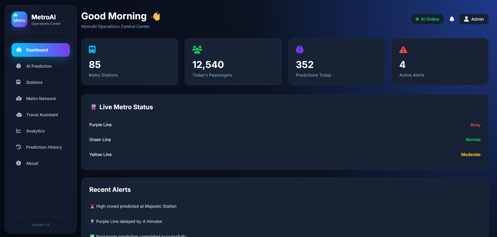
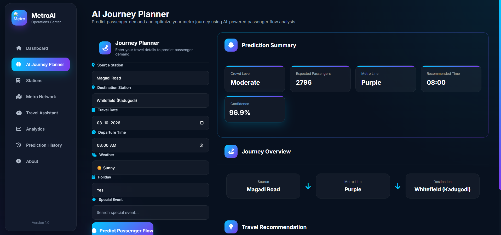

# MetroAI – Smart Metro Operations & Passenger Assistance System

An AI-powered metro operations and passenger assistance system featuring passenger demand prediction, intelligent route planning, and station interchange guidance.

## Overview

MetroAI combines machine learning, metro station data, and a Flask web application to support passenger demand prediction and journey planning.

The project includes a Random Forest model for passenger demand prediction and a route-planning module that helps users navigate between metro stations and identify line changes.

## Features

### 1. AI Passenger Demand Prediction
- Predicts passenger arrivals using a Random Forest regression model.
- Estimates station crowd levels based on predicted passenger arrivals and station capacity.
- Provides travel recommendations based on predicted crowd conditions.

### 2. Metro Travel Assistant
- Select source and destination stations.
- Calculate routes across metro lines.
- Display the sequence of stations along a route.
- Identify interchange stations and line changes.
- Provide step-by-step travel instructions.

### 3. Interchange & Platform Guidance
- Displays arriving and connecting metro lines.
- Provides interchange floor and platform-level information from a station details dataset.
- Displays passenger guidance for changing metro lines.
- Supports journeys involving multiple interchanges.

**Note:** Station floor and platform details are based on collected station information and should be checked against current station signage.

### 4. Metro Network
- Displays metro station and network information.
- Supports visualization of metro routes and station connections.

### 5. Operations Dashboard
- Provides an overview of station information and passenger activity.
- Presents passenger prediction and operational information.

## Screenshots

### Operations Dashboard



### AI Journey Planner



## Technology Stack

- **Frontend:** HTML, CSS, JavaScript
- **Backend:** Python, Flask
- **Machine Learning:** scikit-learn, Random Forest Regressor
- **Data Processing:** pandas, NumPy
- **Model Persistence:** Joblib
- **Metro Routing:** Python-based route engine
- **Network Visualization:** JavaScript and Leaflet/OpenStreetMap, where configured

## Project Structure

```text
MetroAI/
├── app.py
├── train_model.py
├── route_engine.py
├── requirements.txt
├── README.md
├── dashboard.png
├── ai-journey-planner.png
├── data/
│   ├── station_master.csv
│   ├── interchange_details.csv
│   ├── special_events.csv
│   └── passenger_flow.csv
├── models/
│   ├── model.pkl
│   └── label_encoders.pkl
├── templates/
├── static/
│   ├── css/
│   └── js/
└── xtra folder/